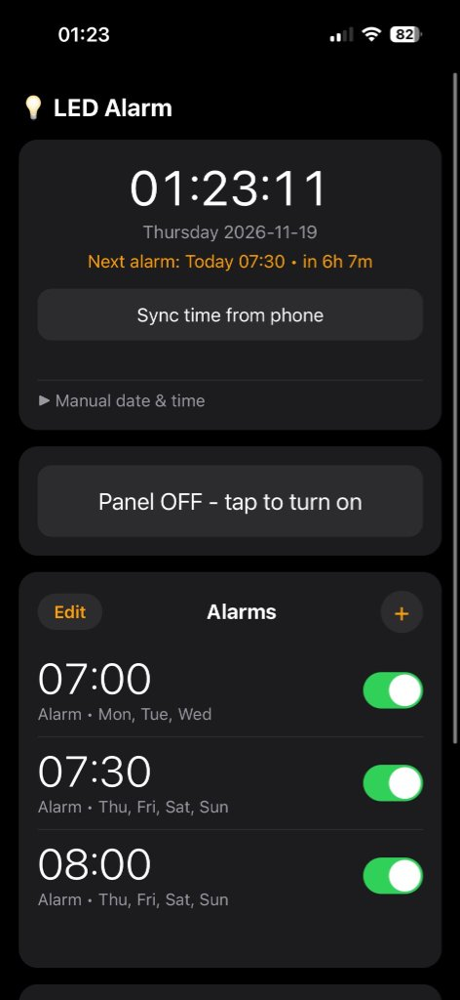
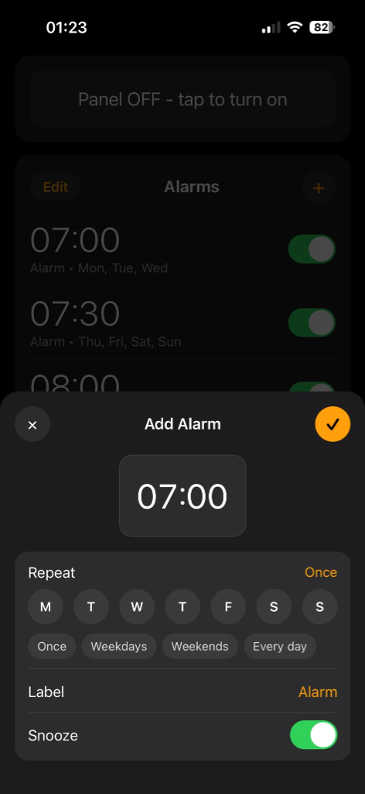
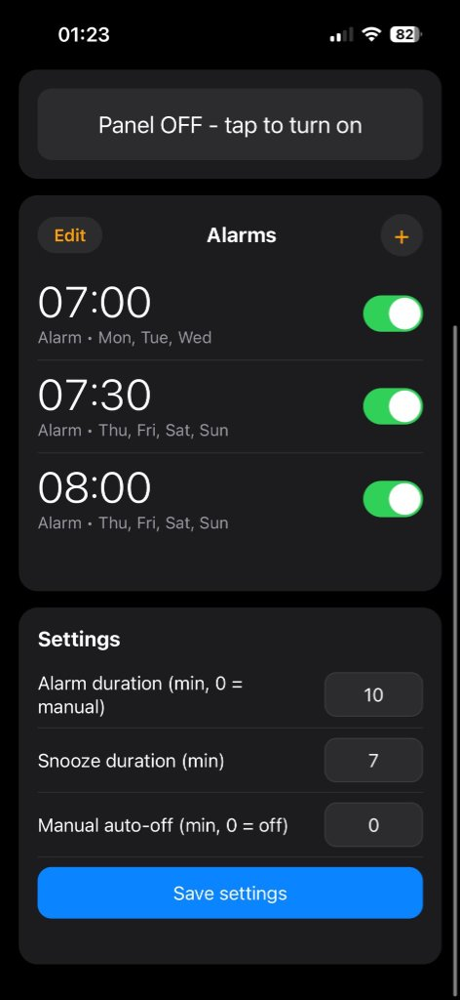
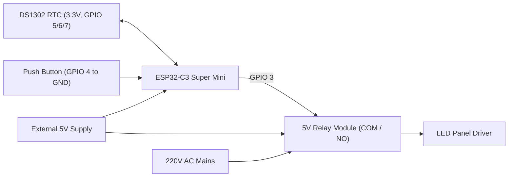

# LED Alarm

ESP32-C3 Super Mini based wake-up light. An LED panel above the bed is switched via a 5V relay at alarm time and can be controlled from a phone or a physical bedside button.

## Web Interface

ESP32 creates its own WiFi Access Point (`LED-Alarm`) with a captive portal at `http://192.168.4.1`.

| Clock, Panel & Alarms | Add / Edit Alarm | Alarms & Settings |
| :---: | :---: | :---: |
|  |  |  |

## Features

- **Multi-Alarm Schedule (up to 20):** Create multiple independent alarms for any day—including multiple alarms on the same day—saved in flash (`Preferences`).
- **iOS-Style Customization:** Configure each alarm with a **label**, **repeat days** (`Once`, `Weekdays`, `Weekends`, `Every day`, or custom `M–S` selection), and per-alarm **Snooze** toggle. One-shot (`Once`) alarms automatically disable after firing.
- **Instant Control:** Toggle alarms on/off directly from the list, or tap **Edit** to delete alarms.
- **Next Alarm Preview:** Shows the upcoming alarm day, time, label, and remaining time (`Today` / `Tomorrow` / weekday).
- **Configurable Durations (saved in flash):**
  - **Alarm duration** (`0–180 min`, default `3 min`, `0 = manual off`)
  - **Snooze duration** (`1–60 min`, default `5 min`)
  - **Manual auto-off** (`0–180 min`, default `0 = off`) for turning the panel off automatically after manual use
- **DS1302 RTC:** Keeps time with its backup battery across power loss.
- **Time Sync:** Automatically syncs from the phone's clock when the web page opens, plus a collapsible **Manual date & time** section.
- **Physical Button:**
  - **Idle:** Toggles the LED panel on/off.
  - **Ringing:** `1 press` = snooze, `2 presses` = stop alarm.
  - **Snoozed:** Any press cancels the alarm.

## Architecture & Wiring

| Part         | Pin     | Connection                    |
| ------------ | ------- | ----------------------------- |
| Relay module | IN / S  | ESP32-C3 `GPIO 3`             |
| Relay module | VCC     | External `5V`                 |
| Button       | one leg | ESP32-C3 `GPIO 4` (other to `GND`) |
| DS1302       | CLK     | ESP32-C3 `GPIO 5`             |
| DS1302       | DAT     | ESP32-C3 `GPIO 6`             |
| DS1302       | RST     | ESP32-C3 `GPIO 7`             |
| DS1302       | VCC     | ESP32-C3 `3.3V`               |
| All GND      |         | Common `GND`                  |

> **Safety:**
> - Disconnect the external `5V` supply before plugging the board into a PC via USB.
> - Connect `220V AC` wires **only** to the relay module's `COM` and `NO` screw terminals inside an insulated enclosure—never route mains voltage onto the perfboard.

## Build & Upload

1. Copy `include/secrets.example.h` to `include/secrets.h` and set your WiFi AP SSID/password.
2. Open the project in VS Code with PlatformIO and run **Upload** (`pio run -t upload`).

Made by Emirhan Şimşek.
